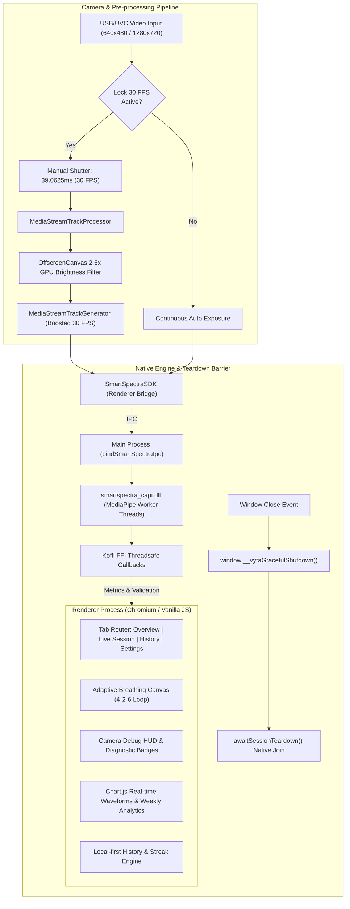

# VYTA — Your Body. Your Rhythm.

> **Real-time contactless physiological sensing and guided breathing wellness desktop application.**  
> Powered by Electron and Presage SmartSpectra Node SDK v3.4.

---

## Overview

**VYTA** is an intentional desktop wellness application designed to harmonize conscious breathing with real-time optical physiological sensing. Built with a bespoke **Obsidian-Forest** aesthetic, VYTA transforms standard consumer webcam streams into synchronized breathwork guidance and clinical-grade contactless physiological telemetry.

All physiological signal processing occurs **locally in memory**. VYTA follows a strict zero-leak, privacy-by-design architecture: video frames are never recorded, transmitted, or written to disk.

---

## Visual Experience & Feature Highlights

### 1. Adaptive Breathing Canvas
- **Deterministic 4-2-6 Breathing Cycle**: Inhale (4s), Hold (2s), Exhale (6s) mapped to a 12-second mindfulness loop.
- **Pacing Engine**: Time-based (never frame-rate dependent) dynamic timing calculations ensuring absolute phase accuracy.
- **Ambient Canvas**: Breathing orb with gentle particle glow, expansion/contraction scaling, and customizable duration selectors (1m, 2m, 3m, 5m, 10m).

### 2. Contactless Physiological Sensing Workstation
- **Powered by Presage SmartSpectra SDK**: Optical rPPG and chest micromotion estimation delivering live respiration rate, respiration waveform, pulse rate, and arterial pressure traces.
- **Zero Vitals Fabrication**: Strict medical telemetry integrity — missing or settling signals display neutral placeholders (`—`), never simulated or smoothed synthetic vitals.
- **Sequential Diagnostic HUD**: Separates hardware readiness, facial landmark tracking, SDK graph status, and signal quality.

### 3. Optical Sensor Reliability & 30 FPS Lock Mode
- **Lock 30 FPS Mode**: Fixes manual shutter time to `39.0625ms` (`exposureMode: manual`), eliminating low-light camera frame drops (7–15 FPS) and delivering a stable **30.45 FPS** stream to satisfy SmartSpectra's $\ge 25\text{ FPS}$ requirement.
- **GPU Software Gain Pipeline**: In low light, an offscreen GPU filter (`MediaStreamTrackProcessor` $\to$ `OffscreenCanvas` brightness filter $\to$ `MediaStreamTrackGenerator`) boosts stream illumination without CPU pixel bottlenecking.

### 4. Privacy-First Onboarding & Consent Gating
- **5-Step Welcome Stepper**: Welcome $\to$ How It Works $\to$ Informed Consent $\to$ Camera Guidance $\to$ Safe Readiness Check.
- **Consent Gating**: Camera permissions are explicitly isolated until informed consent is granted.
- **Non-Invasive Camera Probe**: Hardware is briefly evaluated for resolution/FPS and immediately stopped to release the sensor light.

### 5. Session History, Personal Analytics & Insights
- **Comprehensive Analytics Cards**: Total practices, total mindfulness time, average session duration, current consecutive streak (with yesterday grace period), and record streaks.
- **Weekly Activity Chart**: Interactive Chart.js bar chart showing practice frequency across the rolling 7-day window.
- **Interactive Practice Calendar**: Month-by-month grid highlighting active mindfulness days with one-click date filtering.
- **Deterministic Personal Insights**: Dynamic reflections generated strictly from local session patterns.
- **Session Notes & JSON Export**: Edit reflections, view modality metadata, or export session logs for personal records.

---

## Architecture



---

## Repository Structure

```
vyta/
├── build/                      # Build assets and entitlements
│   └── entitlements.mac.plist
├── docs/                       # Verification reports & screenshots
│   ├── reports/
│   │   ├── phase6-qa-report.json
│   │   └── phase6-baseline-audit.json
│   └── screenshots/
│       ├── phase6-live-sensing.png
│       ├── phase6-regression.png
│       ├── phase5-history-populated.png
│       └── phase4-onboarding-readiness.png
├── index.html                  # Main application shell & view panes
├── styles.css                  # Obsidian-forest design system stylesheet
├── renderer.js                 # Frontend application & breathing engine logic
├── main.js                     # Electron main process & native shutdown handler
├── build.js                    # esbuild bundle configuration
├── package.json                # Application dependencies and package scripts
├── package-lock.json
├── test-phase4.js              # Onboarding & Consent test suite (18/18 tests)
├── test-phase5.js              # History & Analytics test suite (20/20 tests)
├── test-phase6.js              # Real Sensor & Reliability QA suite (16/16 tests)
├── .env.example                # Environment template
└── .gitignore                  # Git exclusions (node_modules, .env, dist)
```

---

## Getting Started

### Prerequisites
- **Node.js**: v22.12+ (Node.js 22 LTS or Node 24 recommended)
- **Camera**: Standard UVC webcam (built-in or USB external)
- **Presage SmartSpectra API Key**: Obtain a key from [Presage Technologies](https://physiology.presagetech.com/)

### Installation

1. **Clone the repository**:
   ```bash
   git clone https://github.com/aastha-yadav2/vyta.git
   cd vyta
   ```

2. **Install dependencies**:
   ```bash
   npm install
   ```

3. **Configure API key**:
   Copy `.env.example` to `.env` and insert your API key:
   ```env
   SMARTSPECTRA_API_KEY=your_actual_presage_api_key_here
   ```

4. **Build and launch**:
   ```bash
   npm start
   ```

---

## Verification & QA Suites

VYTA includes 54 automated integration and regression tests covering all functional and reliability aspects:

```bash
# Run Phase 4 Onboarding & Consent Test Suite (18 tests)
npm run test:phase4

# Run Phase 5 Session History & Analytics Test Suite (20 tests)
npm run test:phase5

# Run Phase 6 Real Sensor Validation & Lifecycle QA Suite (16 tests)
npm run test:phase6
```

All test suites verify:
- Complete camera acquisition and 30 FPS frame rate validation.
- Zero vitals fabrication.
- 5x consecutive rapid Start/Stop lifecycle stress cycles without leaks.
- Graceful shutdown without native Koffi/MediaPipe crashes (`napi_fatal_error`).

---

## License & Copyright

- **VYTA Application**: Copyright © 2026. Built with Presage SmartSpectra SDK.
- **SmartSpectra Node SDK**: Proprietary license by Presage Technologies, Inc.
